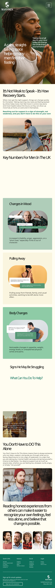
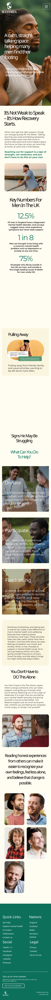

# Many Men – Men Matter

A calm, straight-talking, single-page website supporting men’s mental health and wellbeing. Built as a first solo HTML/CSS/Bootstrap project for a Code Institute skills assessment.

  
  

---

## Table of Contents

- [Overview](#overview)
- [User Experience](#user-experience)
- [Features](#features)
- [UI & Interaction](#ui--interaction)
- [Technologies](#technologies)
- [Design & Wireframes](#design--wireframes)
- [Accessibility](#accessibility)
- [Testing](#testing)
- [Deployment](#deployment)
- [Known Issues](#known-issues--limitations)
- [Future Enhancements](#future-enhancements)
- [Credits](#credits--acknowledgements)

---

## Overview

**Live Site:** https://denmurray10.github.io/Many-Men/  
**Repository:** https://github.com/denmurray10/Many-Men

Many Men is a responsive, single-page site that offers beginner-friendly information about men’s mental health, key warning signs, and practical ways to seek or offer support.

The project was created to demonstrate HTML, CSS, Bootstrap and basic JavaScript skills in the context of a real-world style landing page.

---

## User Experience

### Project Goals

- **External user goal:** Provide accessible, beginner-friendly information on men’s mental health, including common issues, signs, and basic ways to manage stress, presented in a supportive and organised layout.  
- **Site owner goal:** Build a calm, welcoming webpage using HTML, CSS and Bootstrap that demonstrates responsive layouts, card-based content, and form handling while maintaining a reassuring tone.

### Target Audience

- Men who may be struggling with their mental health and need a gentle, low-barrier way to learn more.  
- Friends, partners, colleagues and family members who want to recognise signs that a man might be struggling and know how to support him.  
- Tutors, assessors and potential employers who want to see practical application of HTML, CSS, Bootstrap 5.3.8 and basic JavaScript in a real-world context.

### Core User Stories (Met)

- Understand the site and its purpose at a glance and feel reassured it is a calm, supportive space.  
- Get beginner-friendly information on men’s mental health and why support matters.  
- Recognise signs that a man may be struggling.  
- Know practical ways to support a man in their life.  
- Access trusted external support and resources quickly.  
- Reach out, connect, and stay informed via simple contact options.

### Additional User Stories (Met)

- Browse comfortably on any device using a responsive Bootstrap grid, fluid images and a collapsing navbar.  
- Read content that feels visually calm and accessible through a soft colour palette, consistent typography and generous spacing.  
- Navigate without the navbar feeling intrusive thanks to adaptive scroll and activity-based behaviour.

### Future User Stories (Planned)

- Quickly access urgent crisis support via a prominent “In crisis?” panel or button.  
- Save or print a simple self-help plan with chosen coping steps and crisis contacts.

---

## Features

### Key Sections

- **Hero section:** Introduces the site title, supportive tagline and primary call-to-action.  
- **Statistics section:** Highlights key UK men’s mental health statistics with clear explanations.  
- **“Signs he may be struggling” cards:** Help users recognise behavioural, emotional and physical signs.  
- **Guidance content:** Explains how to seek help, who to talk to and how to support others.  
- **Testimonials-style stories:** Short narratives that normalise struggle and recovery.  
- **Quick links and resources:** Structured external links, including national resources and legal information.  
- **Get help modal:** Supportive guidance text plus a contact form with validation and success messaging.  
- **Newsletter sign-up:** Modal with name/email fields and a success alert to encourage ongoing engagement.

---

## UI & Interaction

- Responsive navbar with brand, section links and mobile collapse behaviour.  
- Scroll and inactivity-based navbar behaviour to reduce distraction while maintaining easy access.  
- Subtle hover effects and overlays on imagery to provide feedback without breaking the calm feel.  
- Smooth layout and spacing using the Bootstrap grid and utility classes.

---

## Technologies

- **HTML5** – Semantic structure for sections, headings, forms and content.  
- **CSS3** – Custom styling for layout, colour palette, typography, cards, overlays and modals.  
- **Bootstrap 5.3.8** – Responsive grid, navbar, cards, modals and utility classes.  
- **JavaScript (vanilla)** – Navbar behaviour, inactivity-based auto-hide, form validation and success message toggling.

### Tools & Workflow

- **Git & GitHub** – Version control and code hosting.  
- **GitHub Pages** – Static site deployment.  
- **Design inspiration:** Layout ideas from Dribbble and Envato Elements, with the final layout designed and implemented by the developer.  
- **AI assistance:** Used to validate HTML structure, refine modal and form logic, and review for potential mistakes or incomplete tags, while keeping decisions human-led.

---

## Design & Wireframes

The design focuses on a calm, supportive experience with clear hierarchy and generous spacing, reflecting the subject matter and the developer’s marketing/design background.

### Layout Previews

  
  
  

These previews show how content, navigation and calls to action adapt across key breakpoints.

---

## Accessibility

Accessibility considerations include:

- Semantic HTML elements for clearer document structure and screen reader support.  
- Colour choices aimed at maintaining sufficient contrast between text and background.  
- Clear, descriptive headings and link text for easy scanning.  
- Form inputs with associated labels and validation feedback.

Planned improvements include deeper keyboard navigation checks, ARIA enhancements for modals, and more systematic use of alt text.

---

## Testing

### Manual Testing

The site was manually tested in modern desktop and mobile browsers to verify:

- Navigation links scroll to the correct sections and the navbar behaves as expected on scroll and inactivity.  
- All main sections render correctly at common screen sizes without horizontal scrolling.  
- Forms in the Get Help and newsletter modals accept valid input, reject invalid input and display success messages.

### Validation

- **HTML:** Validated using the W3C HTML Validator.  
- **CSS:** Validated using the W3C CSS Validator.

#### Validation Screenshots

  
  

### Feature-Level Checks

- Navbar: links, scroll behaviour and mobile toggle.  
- Cards and hover states: overlays and text readability.  
- Modals: open/close behaviour across multiple interactions.  
- Forms: required fields, email format, minimum message length, success alerts and reset behaviour.

---

## Deployment

The site is deployed via **GitHub Pages**:

1. Code is stored in the `main` branch.  
2. GitHub Pages is configured to serve from this branch.  
3. Updates are made locally, committed, pushed to GitHub, and GitHub Pages automatically redeploys the latest version.

**Live URL:** https://denmurray10.github.io/Many-Men/

---

## Known Issues & Limitations

- Minor layout quirks on very narrow screens.  
- Get Help and newsletter forms currently simulate submissions and do not send real emails or store data.  
- Additional accessibility testing with screen readers and ARIA labelling for modals is still planned.  
- Some transitions may feel abrupt on lower-powered devices.

---

## Future Enhancements

- Dedicated “In crisis?” banner and section with clearly highlighted 24/7 crisis support routes.  
- Printable or downloadable “self-help plan” summarising key steps and resources.  
- Deeper accessibility refinements and testing across assistive technologies.  
- Potential expansion into multi-page content or interactive tools.

---

## Credits & Acknowledgements

- **Training & assessment:** Code Institute – for the learning materials, project brief and assessment framework.  
- **Content research:** Mental Health Foundation and other reputable organisations, used to research themes, statistics and support pathways; all external resources are linked rather than copied.  
- **Copy development:** Themes and topics researched using Mental Health Foundation resources, with wording generated and then edited into original text for this project.  
- **Design inspiration:** Visual and layout inspiration from Dribbble and Envato Elements; final layout and styling by the developer.  
- **Developer:** First fully self-coded responsive site by an aspiring full-stack developer with a marketing and design background, focused on supporting men’s mental health.
